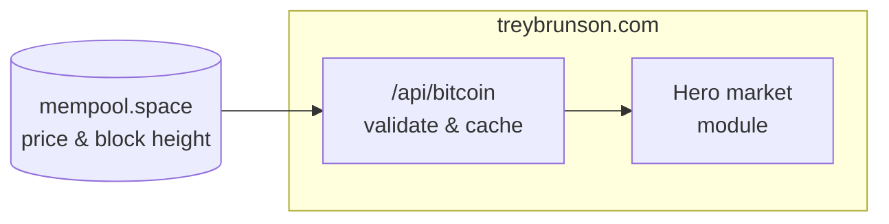

# TreyBrunson.com

The personal site of [Trey Brunson](https://treybrunson.com/), focused on Bitcoin since 2016
and a decade working across crypto exchanges, Bitcoin financial products and crypto venture
funds. It introduces Trey, links to the Secret Satoshis platforms, and shows live Bitcoin
price, supply and market cap.

- **Visit the site:** [treybrunson.com](https://treybrunson.com/)
- **Connect on LinkedIn:** [Trey Brunson](https://www.linkedin.com/in/trey-brunson)

## How it works



The site is a Next.js 16 App Router app in React 19 and TypeScript, deployed on Vercel.
`proxy.ts` sets a Content-Security-Policy with a fresh script nonce on every request.

The hero's market module reads the site's own `/api/bitcoin` route. That route fetches the
current block height and USD price from the public mempool.space API, validates both, and
returns a same-origin response that shared caches may hold for 30 seconds, plus up to 30
seconds while revalidating.

| Figure | Where it comes from |
|--------|---------------------|
| **Bitcoin price** | mempool.space's USD price |
| **Bitcoin supply** | Calculated from the block height and Bitcoin's 210,000-block subsidy schedule |
| **Market cap** | The price multiplied by the calculated supply |

The browser refreshes the module every 60 seconds, starting each refresh only after the
previous one finishes. **Live** labels turn to **Last known** when the price is more than 15
minutes old, the network data more than 5 minutes old, or a refresh fails. Ages are measured
on the server's clock, so a visitor whose device clock is wrong still sees the right label.

## Quick start

You need Node 24 (`.nvmrc`) and pnpm 11.19.0 (`packageManager` in `package.json`).

```bash
git clone https://github.com/SecretSatoshis/Trey-Brunson-Website.git
cd Trey-Brunson-Website
nvm use
pnpm install --frozen-lockfile
pnpm dev
```

Then open [http://localhost:3000](http://localhost:3000). Before pushing, run the same checks
as CI:

```bash
pnpm lint
pnpm audit --prod
pnpm typecheck
pnpm test
pnpm build
```

GitHub Actions runs them on every pull request and every push to `main`; its audit fails on
high-severity advisories. When page content changes, also update `lastModified` in
`app/sitemap.ts`.

## Project layout

| Path | What's there |
|------|--------------|
| `app/page.tsx`, `app/layout.tsx` | The page, its metadata and fonts |
| `app/SupplyHeroModule.tsx` | The hero's live market module |
| `app/api/bitcoin/route.ts` | The validated, cached mempool.space data |
| `app/globals.css` | Page styles |
| `app/not-found.tsx`, `app/robots.ts`, `app/sitemap.ts` | The not-found page, crawler rules and sitemap |
| `proxy.ts` | Per-request Content-Security-Policy and script nonce |
| `public/` | Favicon, social card and headshot |
| `tests/market.test.mjs` | API validation, CSP, polling and freshness labels |

## License

[GPL-3.0](LICENSE).
