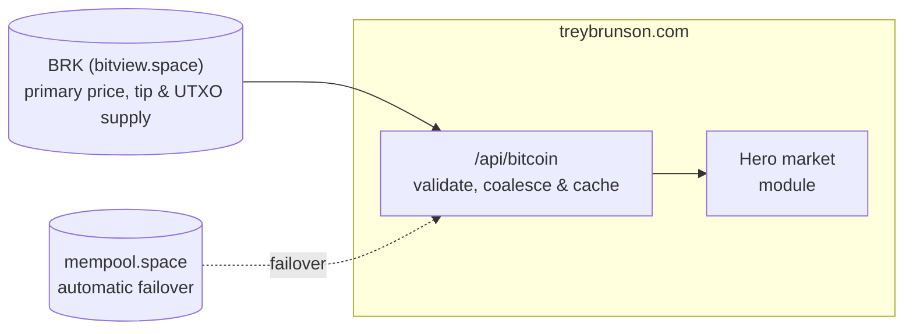

# TreyBrunson.com

The personal site of [Trey Brunson](https://treybrunson.com/), focused on Bitcoin since 2016
and a decade working across management consulting, crypto exchanges, institutional Bitcoin
products, and venture fund operations. It introduces Trey, his Secret Satoshis platforms (the newsletter,
Agent 21, and open-source code), featured articles, and live Bitcoin price, supply, and market
cap linked to the Secret Satoshis Market Dashboard and Chart Library.

- **Visit the site:** [treybrunson.com](https://treybrunson.com/)
- **Read Secret Satoshis:** [newsletter.secretsatoshis.com](https://newsletter.secretsatoshis.com/)
- **Connect on LinkedIn:** [Trey Brunson](https://www.linkedin.com/in/trey-brunson)

## How it works



The site is a Next.js 16 App Router app in React 19 and TypeScript, deployed on Vercel.
`proxy.ts` sets a Content-Security-Policy with a fresh 16-byte random script nonce on every
HTML request, and `instrumentation.ts` runs `lib/tls-trust.ts` on startup to strip
compromised root certificates from Node's outbound TLS trust store.

The hero's market module reads the site's own `/api/bitcoin` route. That route queries BRK
(`bitview.space`) as its primary upstream for USD price, chain tip height, and UTXO
circulating supply, fails over automatically to `mempool.space` (and protocol-scheduled
supply math) if BRK is unavailable, validates all values against mainnet sanity bounds,
rejects unexpected query strings, coalesces concurrent requests with a 15-second in-memory
TTL, and returns a same-origin response that shared caches may hold for 30 seconds plus up
to 30 seconds while revalidating.

| Figure | Where it comes from |
|--------|---------------------|
| **Bitcoin price** | BRK (`bitview.space`) USD price, with automatic failover to `mempool.space` |
| **Bitcoin supply** | BRK UTXO `circulating_supply` (floored to whole BTC), with scheduled halving-era fallback from block height |
| **Market cap** | Price multiplied by supply, formatted in Billions below \$1T and Trillions at or above \$1T |

The browser refreshes the module every 60 seconds while the tab is visible, pausing in
background tabs and refreshing on return if stale. **Live** labels tolerate a single
transient blip while timestamps stay within their freshness window, and turn to **Last
known** when the price is more than 15 minutes old, the network data more than 5 minutes
old, or two consecutive refreshes fail. Server clock offset is derived from HTTP `Date` and
`Age` headers so CDN cache age stays visible in staleness tracking.

## Quick start

You need Node 24 (`.nvmrc`) and pnpm 11.19.0 (`packageManager` in `package.json`).

```bash
git clone https://github.com/SecretSatoshis/Trey-Brunson-Website.git
cd Trey-Brunson-Website
nvm use
pnpm install --frozen-lockfile
pnpm dev
```

Then open [http://localhost:3000](http://localhost:3000). Before pushing, run the same checks
as CI:

```bash
pnpm lint
pnpm audit --prod
pnpm typecheck
pnpm test
pnpm build
```

GitHub Actions runs them on every pull request and every push to `main`; its audit fails on
high-severity advisories. When page content changes, also update `lastModified` in
`app/sitemap.ts`, and keep `public/llms.txt` in step with the page.

## Project layout

| Path | What's there |
|------|--------------|
| `app/page.tsx`, `app/layout.tsx` | The page, JSON-LD entity graph, metadata and fonts |
| `app/SupplyHeroModule.tsx` | The hero's live market module and dashboard/charts links |
| `app/api/bitcoin/route.ts` | BRK-primary / mempool-failover validated, coalesced market API |
| `app/globals.css` | Page styles |
| `app/not-found.tsx`, `app/robots.ts`, `app/sitemap.ts` | The not-found page, crawler rules and sitemap |
| `lib/bitcoin.ts` | Halving-schedule supply math, sanity validators, RFC 9111 clock offset and formatters |
| `lib/tls-trust.ts`, `instrumentation.ts` | Outbound TLS root-CA hardening with resilient fallback |
| `proxy.ts` | Per-request Content-Security-Policy and 16-byte script nonce |
| `next.config.ts` | Static security headers (HSTS, COOP, framing, permissions) |
| `public/llms.txt` | A short guide to Trey and his projects for AI agents |
| `public/` | Favicon, social card and headshot |
| `tests/market.test.mjs`, `tests/tls-trust.test.mjs` | Unit tests for API failover, coalescing, halving boundaries, CSP, polling, freshness and TLS trust |

## License

[GPL-3.0](LICENSE).
